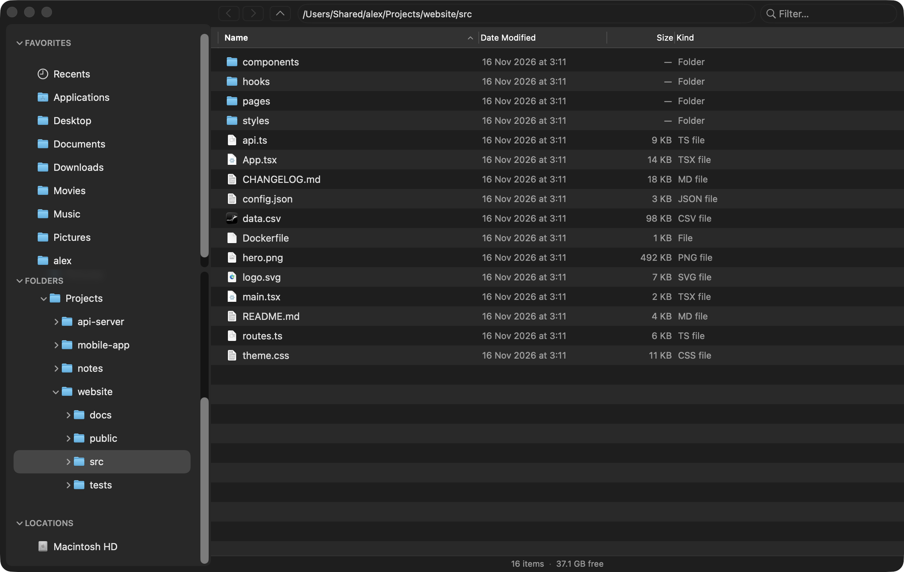
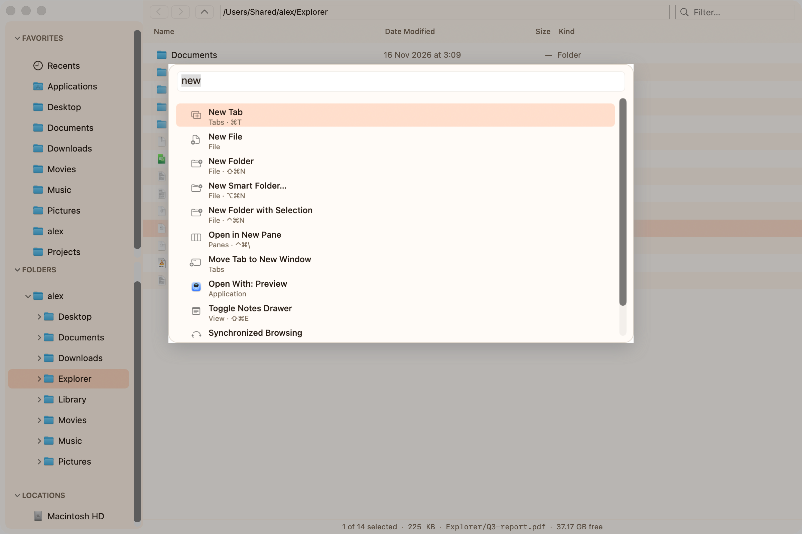

# Explorer

Explorer is a file manager for macOS with the layout of the classic Windows Explorer: a folder tree on the left, a details list on the right, and keys that most people already know. It is a personal fork of [Rascal](https://github.com/chang-07/rascal) by chang, a native AppKit Finder replacement.





Both screenshots use sample files.

## What it does

- **Folder tree.** The left pane shows your folders as a tree. The tree opens down to the folder you are in and selects it, so you always see where you are and what is next to it.
- **Pinned Favorites.** Favorites stay in a fixed strip above the tree. They do not scroll away when the tree gets long, and you can fold the strip.
- **Details list with an address bar.** Back, forward and up buttons, a path you can type into, and a filter for the current folder.
- **Keyboard first.** Windows keys and Mac keys both work. A command palette (`⌘⇧P`) reaches every action.
- **Trash first.** Delete moves files to the Trash, and `⌘Z` puts them back. Undo also covers rename, move, copy, duplicate and new folder.
- **From Rascal, unchanged:** tabs, a second pane, List / Icon / Column / Gallery views, Quick Look, fuzzy file search, search in file contents, batch rename, Finder tags, smart folders, a disk-usage treemap, a terminal drawer, SFTP and network volumes, themes, and an optional vim mode.

## Keys

| Key | Action |
|---|---|
| `Enter` or `⌘↓` | Open the selected folder or file |
| `F2` | Rename |
| `Backspace`, `⌥←` or `⌘[` | Back |
| `⌥→` or `⌘]` | Forward |
| `⌥↑` or `⌘↑` | Parent folder |
| `Delete` (forward delete) or `⌘⌫` | Move to Trash |
| `⌘L` | Edit the address |
| `F5` or `⌘R` | Refresh |
| `Tab` | Switch between the folder tree and the file list |
| Arrow keys in the tree | Move, expand and collapse folders |
| Type letters | Jump to the matching item |
| `Space` | Quick Look |
| `⌘⇧P` | Command palette |
| `⌘F` / `⌘⇧F` | Find files / search in file contents |
| `⌘T`, `⌘\` | New tab, second pane |

The full list is in [HOTKEYS.md](HOTKEYS.md). You can change shortcuts in Settings (`⌘,`).

## Install

There is no download. You build the app on your own Mac. You need macOS 13 or later and the Xcode Command Line Tools (`xcode-select --install`). Full Xcode is not necessary.

```bash
git clone https://github.com/rg1989/explorer.git
cd explorer
./fork-install.sh
```

The script builds a release and installs `Explorer.app` in `/Applications`.

- **Signing.** If your keychain has an "Apple Development" or "Developer ID Application" certificate, the script signs with it, and macOS keeps your privacy permissions across rebuilds. Without one, the build is ad-hoc signed and macOS asks again after each install.
- **Not notarized.** The build is for the Mac that made it.
- **Full Disk Access.** Explorer asks for it on first launch. Without it, macOS asks folder by folder.
- **`install.sh`** is the upstream script. It also installs an `ft` command-line tool. `fork-install.sh` does not.

## What you should know

- **Tested on macOS 26 on Apple Silicon only.** The compact title bar depends on how macOS 26 lays out the sidebar.
- **Permanent delete still exists.** `⌘⌥⌫` deletes immediately after a confirmation. The normal delete keys use the Trash.
- **Git safety.** Explorer shows git status for folders you browse. It blocks three ways a downloaded repository could start a program through its git config (`core.fsmonitor`, an external diff, and textconv). Clean and smudge filters are not blocked, so be careful with repositories from sources you do not trust.
- **No network code.** The app does not phone home and has no update check. It goes online only for servers and network volumes that you connect.
- **Vim mode is off by default.** Turn it on in Settings.

## Development

```bash
./build.sh release     # build build/Explorer.app
./smoketest.sh         # run the in-process tests, off-screen
./snapshot.sh ~/some/folder   # render the window to PNG files, off-screen
```

- The tests and the screenshots run from a separate test bundle (`build/ExplorerTests.app`), so they do not write into the settings of the installed app.
- The Swift target is still named `FinderTwo`, and settings keys start with `FinderTwo.`. These are upstream names, kept so that upstream changes merge cleanly.
- Commands are data: add an entry to `Sources/FinderTwo/Model/Actions.swift`, and the menus and the command palette show it.
- `Package.swift` links only system frameworks. There are no third-party Swift packages.
- `site/`, `docs/`, `netlify.toml` and `wrangler.jsonc` are the upstream Rascal website. This fork does not use them.

Fork-specific code is mainly in:

- `Sources/FinderTwo/UI/SidebarController.swift`: the folder tree and the pinned Favorites strip.
- `Sources/FinderTwo/Window/BrowserWindowController.swift`: Windows keys and the compact title bar.
- `Sources/FinderTwo/FS/GitStatus.swift`: the hardened git calls.

## Credit and licence

Explorer is built on [Rascal](https://github.com/chang-07/rascal) by chang. Almost all of the code is theirs. If you want the original app, with releases and a Homebrew cask, use Rascal. Report bugs in the Rascal engine there; this repository is a personal fork with no support promise.

MIT licence, same as upstream. See [LICENSE](LICENSE).
